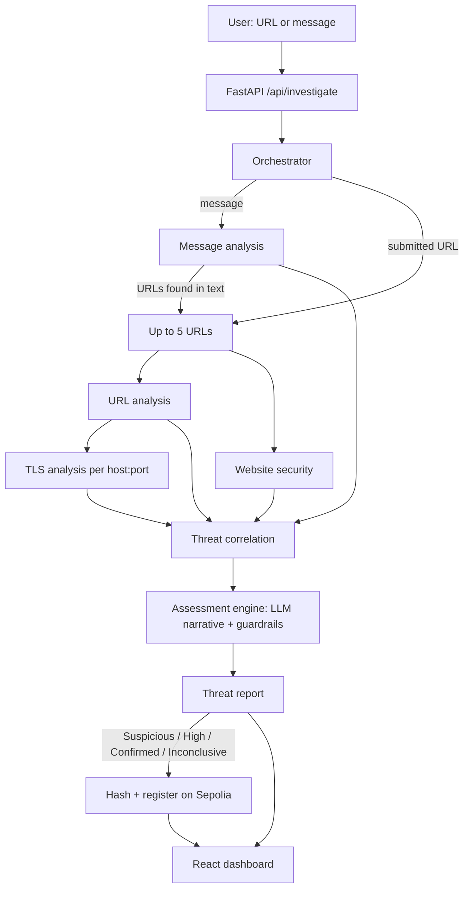

# 🛡️ BanGuard

**Check it before you click it.**

BanGuard is an AI-assisted web threat investigation platform. Paste a suspicious link, domain or message and get a structured, evidence-backed risk assessment in plain language, with every finding traced to the check that produced it. Reports can be fingerprinted and recorded on the Sepolia blockchain so anyone can verify they have not been altered.

> Built for a 48-hour hackathon across **Artificial Intelligence · Cybersecurity · Web3**.

BanGuard never says "this site is safe". It says what it found, what it could not check, and how much evidence it had.

---

## Table of contents

1. [Features](#features)
2. [How it works](#how-it-works)
3. [Risk classification](#risk-classification)
4. [Tech stack](#tech-stack)
5. [Project structure](#project-structure)
6. [Getting started](#getting-started)
7. [Using BanGuard](#using-banguard)
8. [API reference](#api-reference)
9. [Blockchain registry](#blockchain-registry)
10. [Security and privacy design](#security-and-privacy-design)
11. [Testing and demo cases](#testing-and-demo-cases)
12. [Known limitations](#known-limitations)
13. [Roadmap](#roadmap)
14. [Further documentation](#further-documentation)

---

## Features

| Component | What it does |
| --- | --- |
| **URL & domain analysis** | Normalises the URL, then checks for embedded credentials, IP-literal hosts, typosquatting, Punycode and mixed-script homographs, brand names in subdomains, phishing keywords, DNS and WHOIS age, redirect chains (shorteners, cross-domain hops, unsafe destinations) and VirusTotal reputation. |
| **TLS certificate analysis** | Retrieves the certificate and checks validity dates, hostname coverage, self-signed or unknown issuers, chain verification failures, very new certificates, and a local list of distrusted CAs. |
| **Message / scam analysis** | Extracts URLs, emails and phone numbers, then uses an LLM to detect urgency, threats, authority impersonation, financial manipulation, credential requests, prize lures and secrecy. Every flagged snippet must exist word-for-word in the message. |
| **Threat correlation** | Deterministically links a new investigation to earlier ones that share URLs, domains, IPs, emails or phone numbers. |
| **Website security** | Safely fetches the page (no JavaScript executed) and inspects HTTP transport and security headers: HSTS, CSP, X-Content-Type-Options, framing protection, Referrer-Policy and Permissions-Policy. |
| **Decentralised threat intelligence** | Hashes each report (SHA-256 over canonical JSON), versions it, and commits the hash to a Solidity registry on Sepolia. Anyone can re-verify integrity. |
| **Assessment engine** | Combines all signals into one report. An LLM writes the narrative; **deterministic guardrails decide the final risk level**. |

Also included: a React dashboard with a risk "litmus strip", redirect-chain view, message highlighter, evidence log and one-click blockchain verification.

## How it works



1. **Submit** a link, domain or message.
2. **Investigate**: URL analysis and website security run in parallel for each URL (max 5), TLS analysis runs once per unique HTTPS host, and message analysis examines the pasted text.
3. **Correlate**: Threat correlation stores indicators and finds overlaps with previous investigations.
4. **Assess**: signals become a "dossier"; an LLM proposes a verdict and explanation; fixed rules confirm, raise or lower the risk level.
5. **Record**: non-Low reports are hashed and registered on-chain automatically. Low Risk reports are not.
6. **Verify**: the UI can re-check the stored report against the on-chain hash at any time.

## Risk classification

| Level | Meaning |
| --- | --- |
| **Low Risk** | No significant malicious indicators within the checks that ran. *Not* a guarantee of safety. |
| **Suspicious** | One or more indicators need a closer look. |
| **High Risk** | Multiple significant indicators, or one strong indicator plus corroboration. |
| **Confirmed Malicious** | Authoritative evidence, currently 3 or more VirusTotal engines flagging the URL as malicious. |
| **Inconclusive** | Too few checks produced usable results (evidence coverage below 60%). |

Each report includes findings with severity, impact and remediation, the source module of every finding, indicators, an evidence log, recommended actions, evidence coverage, a timestamp and the limitations of the analysis.

## Tech stack

| Layer | Technology |
| --- | --- |
| Backend | Python 3.13, FastAPI, Pydantic |
| URL and DNS intelligence | `httpx`, `dnspython`, `python-whois`, `tldextract`, `idna`, `rapidfuzz`, VirusTotal API v3 |
| TLS | Python `ssl` + `cryptography` |
| Message analysis | Groq API (`openai/gpt-oss-120b`, fallback `llama-3.3-70b-versatile`), `phonenumbers` |
| Storage | SQLite (`banguard.db`) |
| Web3 | Solidity 0.8.20, `web3.py`, Ethereum Sepolia testnet |
| Frontend | React 18, TypeScript, Vite |

## Project structure

```
banguard/
├── api/                      FastAPI app, request models, JSON serializer, API database
├── constants/                Brands, scripts, keywords, shorteners, distrusted CAs
├── contracts/                BanGuardRegistry.sol
├── core/
│   ├── orchestrator.py       Runs the whole investigation
│   ├── assessment_engine.py  Signals -> dossier -> LLM -> guardrails -> report
│   ├── fetch_redirect_chain.py  SSRF-safe HTTP fetcher (IP pinning)
│   ├── network_safety.py     Hostname normalisation + public-IP enforcement
│   └── schema.py             Shared dataclasses (AnalysisResult, ThreatReport...)
├── engines/
│   ├── url_analyzer/         URL analysis
│   ├── tls_analyzer/         TLS certificate analysis
│   ├── message_analyzer/     Message / scam analysis
│   ├── threat_correlation/   Threat correlation
│   ├── website_security/     Website security
│   └── threat_intelligence/  Decentralised threat intelligence (hashing, database, blockchain, verification)
└── frontend/                 React + Vite dashboard
```

## Getting started

### Prerequisites

- Python 3.10+ (developed on 3.13)
- Node.js 18+
- A [Groq API key](https://console.groq.com) (message analysis and report narrative)
- A [VirusTotal API key](https://www.virustotal.com) (free tier works)
- For blockchain features: a Sepolia RPC URL (Alchemy, Infura, etc.), a **throwaway** wallet funded with Sepolia test ETH, and a deployed `BanGuardRegistry` contract

### 1. Clone and install the backend

```bash
git clone <your-repo-url>
cd banguard
python -m venv .venv
source .venv/bin/activate          # Windows: .venv\Scripts\activate
pip install fastapi "uvicorn[standard]" pydantic python-dotenv groq web3 httpx requests \
            tldextract rapidfuzz idna dnspython python-whois cryptography phonenumbers
```

> Tip: freeze these into a `requirements.txt` with `pip freeze > requirements.txt`.

### 2. Configure environment

Create a `.env` file in the project root:

```env
GROQ_API_KEY=your_groq_key
VIRUSTOTAL_API_KEY=your_virustotal_key

# Blockchain (use a disposable test wallet, never a real one)
SEPOLIA_RPC_URL=https://sepolia.infura.io/v3/<key>
SEPOLIA_PRIVATE_KEY=0x...

# Optional
BANGUARD_CORS_ORIGINS=http://localhost:5173,http://127.0.0.1:5173
GROQ_MODEL=openai/gpt-oss-120b
GROQ_FALLBACK_MODEL=llama-3.3-70b-versatile
```

Without `GROQ_API_KEY` the report narrative falls back to a deterministic summary and message analysis fails gracefully. Without `VIRUSTOTAL_API_KEY` threat intelligence is reported as `not_configured` and evidence coverage drops. Without Sepolia settings the investigation still completes, but blockchain registration is reported as failed.

### 3. Deploy the smart contract

1. Open [Remix](https://remix.ethereum.org) and paste `contracts/BanGuardRegistry.sol`.
2. Compile with Solidity `^0.8.20` and deploy to **Sepolia** with your test wallet.
3. Copy the deployed address into `CONTRACT_ADDRESS` in `engines/threat_intelligence/blockchain.py`.

### 4. Run the backend

From the project root (imports are rooted there):

```bash
uvicorn api.main:app --reload --port 8000
```

Check `http://localhost:8000/api/health`. Interactive API docs are at `http://localhost:8000/docs`.

### 5. Run the frontend

```bash
cd frontend
npm install
```

`vite.config.ts` proxies `/api` to a hosted backend. For local development, change the proxy `target` to `http://localhost:8000` (and set `secure: false`), then:

```bash
npm run dev          # http://localhost:5173
```

For a production build, set `VITE_API_BASE_URL` to your API origin and run `npm run build`.

## Using BanGuard

**Link tab:** paste a full URL (including `https://`) and press *Investigate*. You get a verdict, the redirect chain, findings, certificate state, indicators, what could not be checked, and the blockchain record.

**Message tab:** paste an email, SMS or chat text. The message is marked up in place; hover a highlight to see why it was flagged. Links inside the message are investigated too.

**Samples:** use the chips under the Investigate button (a bank-lookalike link, a prize text, a normal site).

> Never paste passwords, OTPs or seed phrases. BanGuard will never ask for them.

### Calling the API directly

```bash
curl -X POST http://localhost:8000/api/investigate \
  -H "Content-Type: application/json" \
  -d '{"investigation_type":"url","url":"https://example.com"}'

curl -X POST http://localhost:8000/api/investigate \
  -H "Content-Type: application/json" \
  -d '{"investigation_type":"message","message":"URGENT: share your OTP at bit.ly/xyz or your account is suspended"}'
```

## API reference

| Method | Path | Description |
| --- | --- | --- |
| GET | `/api/health` | Service and database health |
| POST | `/api/investigate` | Run an investigation. Body: `investigation_type` (`url`, `message` or `combined`), `url`, `message` |
| GET | `/api/investigations/{investigation_id}` | Retrieve a stored investigation |
| GET | `/api/reports/{report_id}` | Retrieve a stored threat report |
| GET | `/api/reports/{report_id}/verify?version=N` | Verify a report against the blockchain |

All responses use the envelope `{ "success": true, "data": ... }`. The `submit_to_blockchain` field is deprecated and ignored; registration is automatic.

## Blockchain registry

- **Network:** Ethereum Sepolia (chain id 11155111)
- **Contract:** `BanGuardRegistry` stores `(reportId, version) -> (contentHash, timestamp, submitter)`
- **On-chain data:** only the SHA-256 fingerprint of the report. URLs, messages and personal data stay off-chain.
- **Versioning:** if a report's content changes it is registered as the next version.
- **Verification:** the stored report JSON is re-hashed and compared with the on-chain hash.

A blockchain record proves a report has not been altered since registration. It does **not** prove the report is true.

## Security and privacy design

- **SSRF protection:** every hostname is resolved, every address must be globally routable, and connections are pinned to the verified IP (defeats DNS rebinding). Redirects are followed manually (max 5) with port, time and size limits.
- **No script execution:** pages are fetched as bounded HTML only (max 1 MiB).
- **Prompt-injection resistance:** the LLM treats all submitted text as untrusted data, must cite signal IDs for every finding (ungrounded findings are dropped), and cannot set the final risk level on its own.
- **Evidence-grounded message analysis:** flagged phrases that do not appear verbatim in the message are discarded.
- **Data minimisation toward the LLM:** URL credentials and query strings are stripped from the dossier before it is sent.
- **Abuse limits:** max 5 URLs per investigation, bounded message length, per-phase timeouts, TLS limited to ports 443 and 8443.
- **Non-intrusive:** passive inspection only; no exploitation or active scanning.

## Testing and demo cases

Suggested cases for demos and the testing report. Record observed results as you run them.

| # | Type | Input | What to look for |
| --- | --- | --- | --- |
| 1 | Suspicious | `https://secure-verify-hdfc.top/login?kyc=update` | Brand + keywords + unusual TLD |
| 2 | Suspicious | Prize/OTP message from the sample chips | Credential request, urgency, prize lure, shortener link |
| 3 | Suspicious | A currently listed phishing URL from a public feed (e.g. OpenPhish) | VirusTotal detections |
| 4 | TLS | `https://expired.badssl.com` | Expired certificate |
| 5 | TLS | `https://self-signed.badssl.com` | Self-signed / untrusted issuer |
| 6 | TLS | `https://wrong.host.badssl.com` | Hostname mismatch |
| 7 | Benign | `https://www.wikipedia.org` | Low risk, hygiene-only findings |
| 8 | Benign | `https://github.com` | Low risk |
| 9 | Benign | A genuine bank "never share your OTP" notice | Informational language not labelled as fraud |

## Known limitations

- Threat intelligence currently relies on VirusTotal; URLs it has never seen return `no_report`.
- Typosquatting uses a small built-in brand list.
- Page *content* is fetched but not yet analysed (no login-form or brand-logo detection).
- Certificate revocation, Certificate Transparency lookups, key-size and signature-algorithm checks are not implemented.
- The distrusted-CA list is local and small; it reflects third-party distrust intelligence, **not** independent detection of CA key-generation weaknesses.
- Correlation matches exact indicator values only and can link unrelated investigations through popular shared domains.
- Scoring is rule-based and has not been calibrated on a labelled dataset.

## Roadmap

- Additional feeds: Google Safe Browsing, URLhaus, OpenPhish, PhishTank
- Certificate Transparency monitoring via crt.sh
- Page-content analysis (password fields, form targets, brand impersonation)
- Deterministic brand-versus-domain mismatch check for messages
- Browser extension for pre-navigation checks
- Rate limiting, authentication and a persistent production database

## Further documentation

See [`WRITEUP.md`](WRITEUP.md) for the project write-up: the problem, the design decisions, how an investigation flows from submission to on-chain verification, the security model, and honest limitations.

## Team

| Name |
| --- |
| Priyanshu Maity |
| Abhineet Bhattacharjee |

## License

BanGuard is released under the MIT License.

```
MIT License

Copyright (c) 2026 Priyanshu Maity, Abhineet Bhattacharjee

Permission is hereby granted, free of charge, to any person obtaining a copy
of this software and associated documentation files (the "Software"), to deal
in the Software without restriction, including without limitation the rights
to use, copy, modify, merge, publish, distribute, sublicense, and/or sell
copies of the Software, and to permit persons to whom the Software is
furnished to do so, subject to the following conditions:

The above copyright notice and this permission notice shall be included in all
copies or substantial portions of the Software.

THE SOFTWARE IS PROVIDED "AS IS", WITHOUT WARRANTY OF ANY KIND, EXPRESS OR
IMPLIED, INCLUDING BUT NOT LIMITED TO THE WARRANTIES OF MERCHANTABILITY,
FITNESS FOR A PARTICULAR PURPOSE AND NONINFRINGEMENT. IN NO EVENT SHALL THE
AUTHORS OR COPYRIGHT HOLDERS BE LIABLE FOR ANY CLAIM, DAMAGES OR OTHER
LIABILITY, WHETHER IN AN ACTION OF CONTRACT, TORT OR OTHERWISE, ARISING FROM,
OUT OF OR IN CONNECTION WITH THE SOFTWARE OR THE USE OR OTHER DEALINGS IN THE
SOFTWARE.
```

> **Disclaimer:** BanGuard provides indicators, not guarantees. Always verify sensitive requests through an organisation's official channels.
